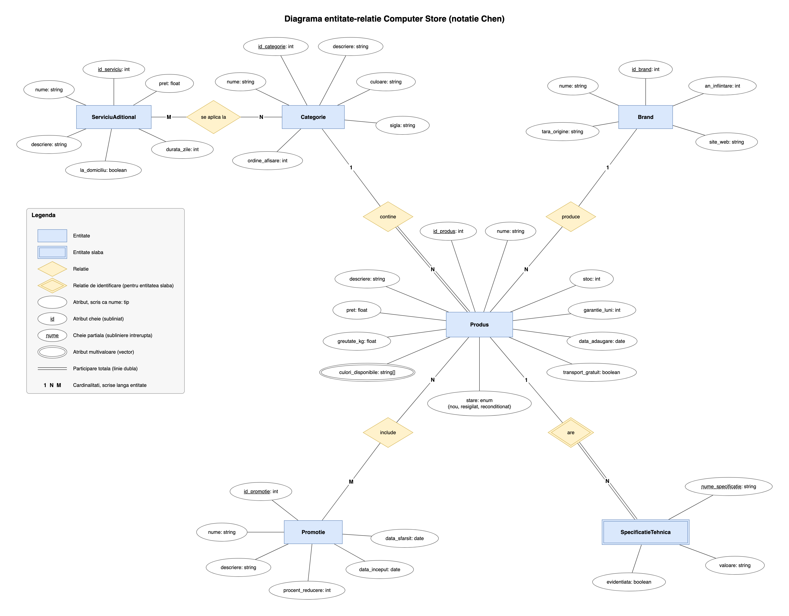

# Computer Store

Magazin online de componente si sisteme pentru calculatoare: procesoare, placi video, placi
de baza, memorii, stocare, monitoare si periferice.

## Continut

Toate paginile sunt in aplicatia `store`, montata la `/store/`.

| Pagina | URL | Descriere |
|---|---|---|
| Pagina principala | `/store/` | Prezentarea magazinului, in 5 sectiuni: Despre magazin (cu imagine), Promotii curente, Categorii de produse, Program de lucru, De ce sa cumperi de la noi. |
| Despre noi | `/store/despre` | Cine suntem (cu imagine) si Echipa. |
| Istoric | `/store/istoric` | Momentele importante din istoria firmei, de la infiintare pana azi. |
| Produse | `/store/produse` | Catalogul de produse, cu filtre. Va fi implementata intr-un laborator urmator. |
| Contact | `/store/contact` | Formular de contact si datele firmei. Va fi implementata intr-un laborator urmator. |
| Cos virtual | `/store/cos_virtual` | Produsele adaugate in cos si plasarea comenzii. Va fi implementata intr-un laborator urmator. |
| Configurator PC | `/store/configurator` | Pagina aleasa de noi. Clientul alege componentele unui sistem pas cu pas, iar pagina verifica daca sunt compatibile (soclu, tip de memorie, putere sursa). |
| Service | `/store/service` | Pagina aleasa de noi. Serviciile atelierului propriu (asamblare, diagnosticare, reparatii, upgrade) si tarifele lor. |
| Informatii server | `/store/info` | Data si ora serverului. Parametrul `data=zi` afiseaza doar data, `data=timp` doar ora. |
| Jurnal accesari | `/store/log` | Toate accesarile paginilor de la pornirea serverului. Parametri: `ultimele`, `iduri`, `dubluri`, `accesari` (`nr`, `detalii`), `tabel` (`tot` sau lista de proprietati). |
| Accesare | `/store/accesare[id]` | Toate informatiile despre accesarea cu id-ul dat. |

Paginile Produse, Contact, Cos virtual, Configurator PC si Service randeaza deocamdata
template-ul `in_lucru.html`.

## Date firma

Datele firmei sunt in dictionarul `DATE_FIRMA` din `computer_store/settings.py`. Context
processor-ul `store.context_processors.date_firma` le trimite catre toate paginile, care le
afiseaza in footer.

| Cheie | Descriere |
|---|---|
| `nume` | Numele firmei |
| `an_infiintare` | Anul infiintarii |
| `telefon` | Numarul de telefon |
| `adresa` | Adresa sediului principal |
| `email` | Adresa de email pentru contact (caracteristica aleasa de noi) |
| `program` | Programul de lucru al magazinului fizic, o lista cu cate un interval pe zile (caracteristica aleasa de noi) |

## Baza de date

Diagrama este in notatie Chen. Sursa editabila este `diagrama_bd.drawio` (se deschide in draw.io, iar dupa modificari se exporta din nou ca `diagrama_bd.png`).

### Entitati si atribute

Cheile primare sunt subliniate in diagrama. Cheile straine nu apar ca atribute, ele rezulta din relatii.

- **Categorie**: grupeaza produsele (procesoare, placi video, memorii etc).
  - `id_categorie: int` cheia primara
  - `nume: string`
  - `descriere: string`
  - `culoare: string` culoarea reprezentativa (cod hex), folosita la stilizare
  - `sigla: string` calea catre imaginea siglei (fisier SVG, PNG, JPG sau WEBP)
  - `ordine_afisare: int` pozitia categoriei in meniuri si liste
- **Brand**: producatorul unui produs.
  - `id_brand: int` cheia primara
  - `nume: string`
  - `tara_origine: string`
  - `an_infiintare: int`
  - `site_web: string`
- **Produs**: un produs vandut de magazin. Atributele sunt alese si pentru filtrele de mai tarziu.
  - `id_produs: int` cheia primara
  - `nume: string`
  - `descriere: string`
  - `pret: decimal` pretul de vanzare, in lei
  - `stoc: int` numarul de bucati disponibile
  - `garantie_luni: int`
  - `data_adaugare: datetime` data si ora la care produsul a fost adaugat in magazin
  - `stare: enum` una dintre valorile nou, resigilat, reconditionat
  - `transport_gratuit: boolean`
  - `greutate_kg: float`
  - `culori_disponibile: string[]` atribut multivaloare, de exemplu [negru, alb]
- **SpecificatieTehnica** (entitate slaba): o caracteristica tehnica a unui produs, de exemplu Frecventa = 3.6 GHz sau Memorie video = 8 GB.
  - `nume_specificatie: string` cheia partiala
  - `valoare: string`
  - `evidentiata: boolean` daca specificatia apare pe cardul produsului
- **Promotie**: o campanie de reduceri pe o perioada data.
  - `id_promotie: int` cheia primara
  - `nume: string`
  - `descriere: string`
  - `procent_reducere: int`
  - `data_inceput: date`
  - `data_sfarsit: date`
- **ServiciuAditional**: un serviciu oferit pe langa produse (asamblare, instalare sistem de operare, garantie extinsa, transport).
  - `id_serviciu: int` cheia primara
  - `nume: string`
  - `descriere: string`
  - `pret: decimal`
  - `durata_zile: int` in cate zile este efectuat serviciul
  - `la_domiciliu: boolean` daca serviciul se poate face la client acasa

### Relatii

| Relatie | Entitati | Cardinalitate | Explicatie |
|---|---|---|---|
| contine | Categorie, Produs | 1 : N | Fiecare produs are exact o categorie (participare totala a lui Produs), o categorie are oricate produse. |
| produce | Brand, Produs | 1 : N | Fiecare produs are exact un brand (participare totala a lui Produs), un brand are oricate produse. |
| are | Produs, SpecificatieTehnica | 1 : N | Relatie de identificare. Fiecare specificatie apartine exact unui produs (participare totala). |
| include | Promotie, Produs | M : N | O promotie cuprinde mai multe produse, un produs poate fi in mai multe promotii. Tabelul asociativ nu apare in diagrama. |
| se aplica la | ServiciuAditional, Categorie | M : N | Un serviciu se ofera pentru mai multe categorii (asamblarea pentru procesoare, placi de baza, placi video), o categorie are mai multe servicii. |

Nu exista relatii one-to-one.

### Entitatea slaba

SpecificatieTehnica este entitate slaba, deoarece:

- nu are o cheie proprie: `nume_specificatie` (de exemplu Frecventa) se repeta la multe produse, deci nu identifica singura o specificatie;
- este identificata de cheia produsului impreuna cu cheia partiala, adica (`id_produs`, `nume_specificatie`);
- nu are sens fara produs: Frecventa = 3.6 GHz nu spune nimic daca nu stim la ce procesor se refera;
- la stergerea unui produs se sterg si specificatiile lui.

### Tipuri de atribute folosite

| Tip | Atribute |
|---|---|
| string | nume, descriere, culoare, sigla, tara_origine, site_web, nume_specificatie, valoare |
| int | stoc, garantie_luni, an_infiintare, ordine_afisare, procent_reducere, durata_zile |
| decimal | pret |
| float | greutate_kg |
| date | data_inceput, data_sfarsit |
| datetime | data_adaugare |
| boolean | transport_gratuit, evidentiata, la_domiciliu |
| enum | stare (nou, resigilat, reconditionat) |
| vector (string[]) | culori_disponibile |

### Forma normala 3

- **1NF**: toate atributele au valori atomice, cu exceptia `culori_disponibile`, care este vectorul cerut in enunt (singura abatere permisa). Fiecare entitate are o cheie.
- **2NF**: entitatile cu cheie simpla nu pot avea dependente partiale. Singura cheie compusa este cea a lui SpecificatieTehnica (`id_produs`, `nume_specificatie`), iar `valoare` si `evidentiata` depind de cheia intreaga: aceeasi specificatie are alta valoare la alt produs. Din acest motiv unitatea de masura nu este un atribut separat, deoarece ar fi depins doar de `nume_specificatie`.
- **3NF**: niciun atribut care nu face parte din cheie nu depinde de un alt astfel de atribut. Datele despre categorie si brand nu se repeta in Produs, ci sunt in entitati separate (de exemplu `tara_origine` este la Brand, nu la Produs).
- **Fara atribute calculabile**: nu exista `pret_redus` (se calculeaza din `pret` si `procent_reducere`), `promotie_activa` (rezulta din data curenta, `data_inceput` si `data_sfarsit`), `in_stoc` (rezulta din `stoc`) sau vechimea brandului (rezulta din `an_infiintare`).
